# Tutoriel

Ce document est destiné à expliquer comment utiliser et lancer la maquette pour obtenir des mesures.
Le post-traitement, notamment sur la manière dont il est utilisé, n'est pas abordé dans ce document et est expliqué dans les cours par M. Helbert.
Les problèmes qui apparaissent à l'usage de la maquette sont abordés dans ce document avec le but de pouvoir les passer sans prendre des semaines.


## Utilisation classique

### Au préalable

Utiliser la maquette requiert au préalable plusieurs choses :

- La maquette peut être mise en puissance (maintien du kas).
- La carte STM32 est détectée & peut se lancer en mode debug.
- Le pc peut exécuter l'intégralité du code python.
- Les modules python sont bien importés.
- Les masses ne posent pas de problèmes majeurs.
- L'arrêt d'urgence fonctionne.

Ces points sont admis dans la suite de ce tutoriel. En case de problème, se référer à la partie [#Problèmes à l'usage](#Problèmes_à_l'usage_et_comment_les_résoudre).

### Mise en place

Avant de lancer une mesure, il faut lancer le script python et le code STM32.

**Sur Jupyter Notebook :**

1. Lancez la connexion uart à l'aide du script, puis vérifiez ensuite que la connexion reste ouverte.
Sur Windows cependant, il faut manuellement rentrer le port COMx utilisé. Ci-dessous un retour correct.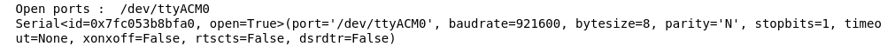

2. Initialisez toutes les fonctions de read & write.

Si il n'y a aucune erreur, alors le programme est prêt à être utilisé.

**Sur STM32CubeIDE :**

1. Lancez le Workspace du projet. Si le projet n'est pas dedans, il faut l'importer (le fichier .ioc et les fichiers */src* et */inc*) et autoriser la gestion des float par le printf (dans le C/C++ Builder) 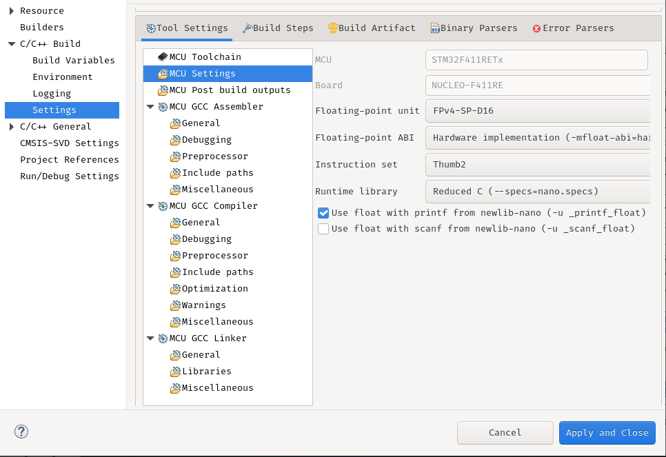

2. Compilez à l'aide du marteau. A la remise finale du projet, tout le code fonctionne sans problème, mais des problèmes de workspace peuvent apparaître. Essayez de clean le workspace et recompilez, si cela ne fonctionne pas, se réferez à l'étape 1 et les problèmes.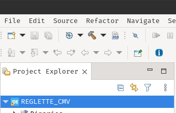

3. Lancez le mode debug mais ne lancez pas le début du programme (rester sur *HAL_Init()*). 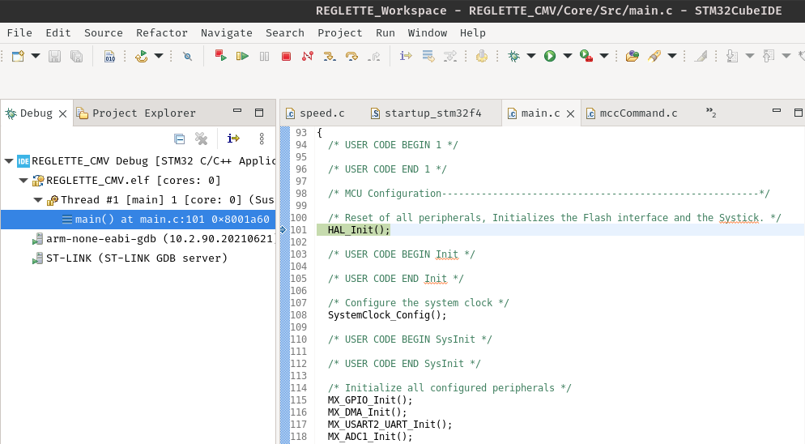


Si il n'y a pas de problèmes, le programme est prêt.

#### Vérification

1. Avant de lancer la connexion sur Jupyter Notebook, il faut lancer gtkterm sur Linux ou putty sur Windows. Le baudrate du projet est 926200 baud/s.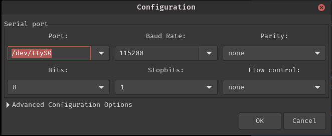

2. Lancez l'intégralité de la STM32 et **ne restez pas** sur *HAL_Init()*, lancez le projet sans pour autant toucher au reste. Sur le terminal série doivent désormais apparaîtrent des lignes sous la forme suivante ``` 0x01;...;0x09;... ```. Si des caractères losanges-points d'interrogations apparaîssent, vérifiez de nouveau le baudrate.

Si la carte retourne correctement des valeurs, alors l'installation fonctionne. Si ce n'est pas le cas, vérifiez l'installation et le projet, la carte en ultime ressort. 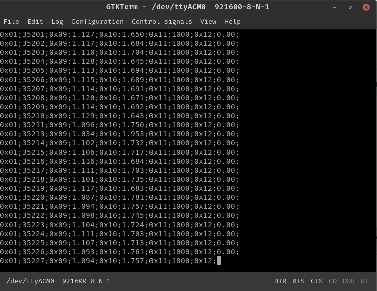

3. Coupez ensuite le terminal série, puis faites ```data_serial.close()``` et relancez le script de connexion.

4. Relancez le mode debug du projet.

### Mesures

La carte émet en continue les données de mesures, de telle manière que même si la carte est destabilisée ou coupée de son mode debug, elle continue d'être utilisable.
Dès lors, c'est le script python qui décide quand écouter ce qu'émet la STM32.

Pour écouter, il faut :

1. Avoir une connexion active SANS terminal série

2. Utiliser 
```python
data = read_data(nline)
#puis
data = compute_data_table(dt = data)
#puis
current_measure = all_getTable(dt = data)
```

Des fonctions mesures toutes prêtes sont fournies. Elles mettent en place des threading pour paralleliser la lecture et la commande.

```python
measure_release(te_ms, period_ms)
#et 
measure_forced_vibrations(te_ms, length_ms, max_freq, freq_step, min_freq)
```

Dans l'état actuel (S2024P), *measure_release()* est fonctionnel mais la commande de l'éléctroaimant non, ce qui rend la mesure non fonctionnel en l'état. En pratique, la mesure en relâche se fait en maintenant avec un doigt ou un stylo l'electroaimant. On lance la mesure avec *read_data()* et on relâche peu après (laisser ~1s). 

*measure_forced_vibrations()* est aussi fonctionnelle, si tenté que le moteur est correctement monté et que la partie puissance ne subit pas de problèmes de masses handicapants.

Pour lancer une mesure en vibration forcée, à l'aide du moteur :

1. Branchez la maquette en puissance à l'aide du chargeur. C'est le cas si la LED rouge "E" est allumée.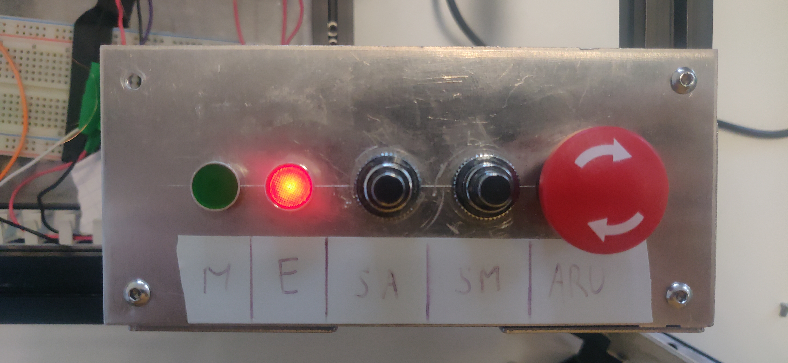. 

2. Appuyez sur SM. C'est le cas si la LED verte "M" est allumée. 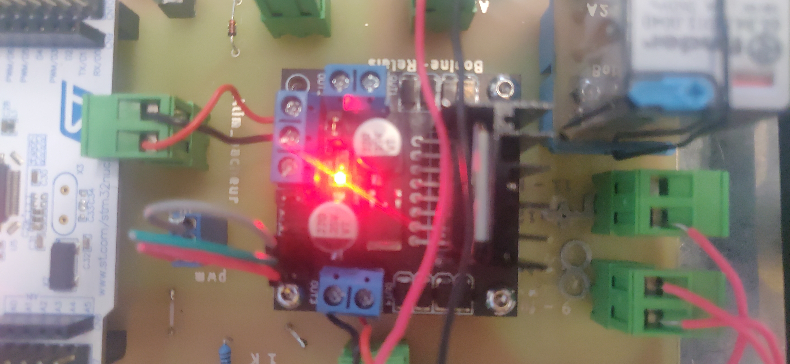. 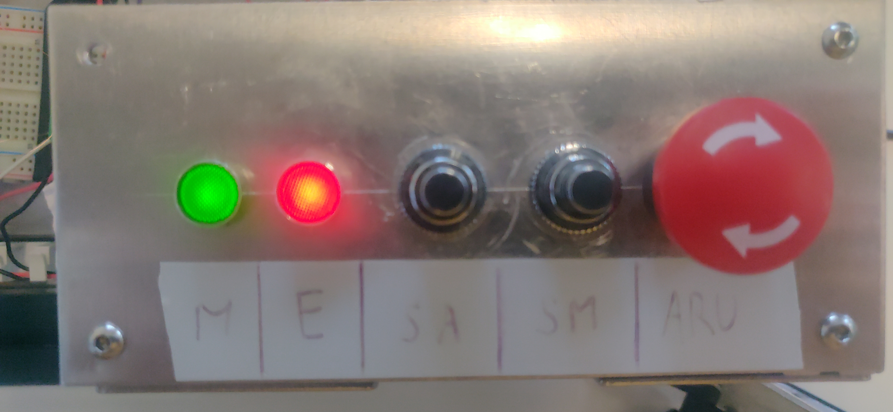.

3. Le moteur est correctement monté.

4. L'excentrique est correctement monté.

Vous pouvez tester en mettant un duty cycle supérieur à ~1V/5%. Le moteur doit alors se mettre en mouvement et faire mouvoir la réglette. La mesure peut donc se lancer. 

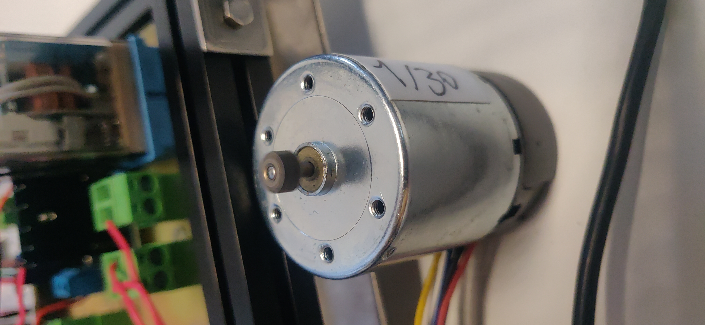

### Commande

L'appel à la commande est rare et se fait à l'initiative de l'utilisateur. Toutes les fonctions sont fournies dans ``` stm32_com.ipynb ```.

Il peut être pertinent de mettre des valeurs/commandes par défaut directement dans le code de la carte. Les fonctions sont fournies dans la documentation technique.
Pour mettre en place de la commande à chaque redémarrage de la carte, il faut effectuer les commandes suivantes:
```c
// =========================
...
//code de commande ici
...
// =========================
tickTimer_Init(1);
while(1)
{
	//jamais rien
}
```

Sinon, il est tout à fait possible de commander depuis le PC. Des fonctions sont prévues et sont fonctionnelles. Voir documentation du code pour la liste complète. Quelques exemples :
```python
uart_send_mag(state_int)
#envoie l'état choisi du magnet, avec 1 pour le faire sortir

uart_send_voltageValue(voltage_value)
#Envoie une valeur de tension à l'entrée du moteur

uart_send_command(command)
#Envoie une commande de tr/min pour le filtre PID
```

### Export

Pour partager les mesures entre membres ou entres Jupyter Notebook, il existe une portion de script qui écrit et lit en .csv :
```python
import csv

# Ne pas hésiter à modifier Px selon la position
with open('Measurements/PxFRF.csv', mode='w') as PxFRF:
    PxFRF_writer = csv.writer(PxFRF, delimiter=';', quotechar='"', quoting=csv.QUOTE_MINIMAL)
    # Lit le fichier séléctionné et crée un éditeur 

    for i in range(len(current_measure)): # parcourt l'ensemble de fichier
        line = [current_measure[i][0], current_measure[i][2]]
        PxFRF_writer.writerow(line)
    print("out")
```

Pour lire dans le même fichier (ie. vérifier le bon export) :
```python
PxFRF_data = []
with open('Measurements/PxFRF.csv') as csv_file:
    csv_reader = csv.reader(csv_file, delimiter=';')
    # crée un éditeur de fichier 
    line_count = 0
    for row in csv_reader:
        P1FRF_data.append([float(row[0]), float(row[1])])
    print("out")
```
La mise en graphe est une bonne pratique pour vérifier :
```python
def extract_table(dt, index):
    ndt = [0]*len(dt)
    for i in range(len(dt)):
        ndt[i] = dt[i][index]
    return ndt

plt.plot(extract_table(P1FRF_data, 0), extract_table(P1FRF_data, 1))
```

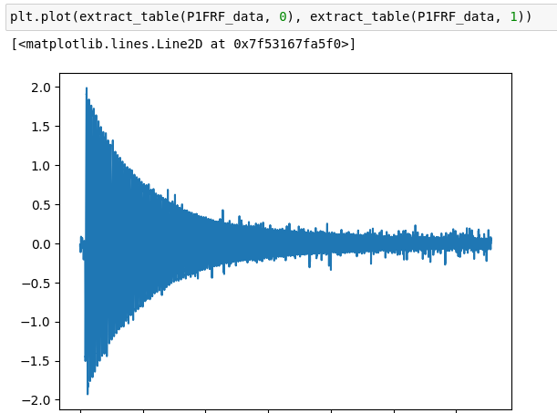

### Post-traitements

Après la mesure, les post-traitements des données issues de l'acceléromètre se font dans des programmes différents, en partie pour ne pas surcharger des scripts de mesure, en autre partie pour pouvoir y intégrer plus de calculs issus du cours.
A l'heure de l'écriture de ce tutoriel, le script pour le régime libre est une version simplifiée (mais pas moins complète) du script donné par M. Helbert. Le script de traitement du régime harmonique est quand à lui fonctionnel mais sans simplifications.

Pour utiliser les scripts :

1. Lancez le jupyter notebook associé au traitement et type de mesure réalisée.

2. Vérifiez que vous possédez les modules pythons.

3. Vérifiez que vous possédez des mesures en CSV avec comme délimiteurs ";". Portion exemple : 
```
0.0;-0.035
0.001;-0.023
0.002;-0.014
0.003;-0.023
0.004;-0.031
0.005;-0.025
0.006;-0.024
0.007;-0.023
0.008;-0.023
0.009;-0.022
```

4. Dans la portion d'importations des CSV, une section de tests est présente dont voilà un exemple 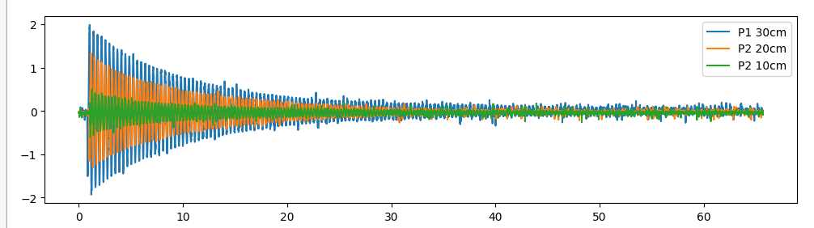

$~~~$

## Points de vigilance

### La masse

La masse est le point le plus impactant sur les mesures, la stabilité du système et la vie des composants. A l'heure actuelle (S2024P), la maquette est parcourue par de nombreux problèmes de masse, il faut donc être particulièrement vigilant sur plusieurs points :

- La masse de l'acceléromètre **doit** être celle de la carte. Peu importe si celle-ci passe par la carte, est la même que la carte et autres composants ou est directement issue d'une pin, la bonne qualité des mesures ne passe que par cela.

- Vérifiez que le châssis est à la masse, que ce soit celle d'une alimentation ou celle directement du hacheur. Dans notre cas, taper sur la table faisait redémarrer la carte STM32.

- Séparez bien les Points Uniques de Masses. La partie puissance (du moteur et de l'electroaimant) doit être séparée de la partie acquisition.

### Moteur

Avant de monter le moteur sur les pins, vérifiez en puissance que où se situe le 5V et la masse. Le moteur ne sera pas abimé, l'encodeur digital si.

Vérifiez que les jeux de montages entre le motoréducteur et le translateur en métal sont corrects : ils doivent permettre des très petits mouvements sans déclencher la translation pour compenser le jeu du réducteur et du plastique d'impression 3D. Sans ce jeu, un échauffement important peut apparaître (comme en témoigne le bleu des bielles métalliques).

### Connexions

Les connexions de la carte sont faites à la main et peuvent donc être fautives dans la mauvaise commande ou acquisition. Comment les identifier :

1. Identifier les points de soudures entre les connecteurs et la plaque jaune.
2. Tester la continuité ou la résistivité entre la sortie du connecteur et la piste qui provient de la soudure.

Si la continuité n'est pas assurée (ou bien une résistance très haute) :

* Resouder la connexion

* Remplacer le composant

### Fils

Les fils qui servent d'alimentation ne sont en général pas à regarder. Ceux qui sortent pour les parties d'acquisition sont cependant très importants. 

Ces fils peuvent servir d'antenne pour des ondes éléctromagnétiques ou de bobines pour le courant. Il faut donc réduire leurs longueurs au strict minimum, éviter de les mettre proche des sources d'alimentations et les rendre droits pour ne pas en faire des bobines.

$~~~$

## Problèmes à l'usage et comment les résoudre

Liste des problèmes avec les moyens de les résoudre en allant **crescendo**.
Chaque problème est abordé indépendamment.
Chaque passage numéroté se repose sur les points précédents, c'est à dire qu'il faut d'abord traiter les points les plus bas avant de continuer.

**La maquette ne peut pas être mise en puissance (maintien du kas) :**

1. Vérifiez que la maquette est correctement branchée et que le fusible n'est pas consommé.
2. Vérifiez que l'arrêt d'urgence n'est pas enclenché.
3. Vérifiez que le courant parvient bien au relais et au hacheur.
4. Vérifiez que les câbles sont bien connectés selon les photos/vidéos/schémas

$~$

**La carte STM32 ne peut pas se lancer en mode debug :**

1. Vérifiez que la carte est bien branché à un port USB **fonctionnel**.
2. Vérifiez que STM32CubeIDE est correctement lancé et dispose des droits suffisants pour accéder aux ports USB.
3. Le code ne doit pas avoir d'erreurs de compilation et présenter + d'une dizaine de warning.
4. Si malgré ces étapes, le code ne se lance toujours pas en débug, il faut alors exporter le projet puis le réimporter dans un nouveau projet.

$~$

**Les modules python ne sont pas correctement importés :**

1. Dans ```import serial```, serial se réferre à *pySerial* et non à serial (qui est un autre module). Pour l'installer : ```pip uninstall serial; pip install pyserial```.
2. Vérifiez que le ```$PATH``` est bien le même que pip, sinon le module ne sera pas trouvé.

$~$

**Le pc ne peut pas exécuter l'intégralité du code python :**

1. Si c'est un problème de module, voir le point précédent.
2. Si ce n'est pas un problème de module, il faut résoudre individuellement le problème. Vérifiez tout de même que le code est executé dans l'ordre.

$~$

**Problèmes de masse :**

1. Voir les points de vigilances.
2. Mettez le châssis à la masse, soit celle d'un générateur, soit celle du hacheur.
3. Mettez les plans de masse de la carte à la masse d'un générateur.
4. Vérifiez les soudures.
5. Vérifiez que la masse n'est pas à plus de 0.1 V.
6. Changer la carte jaune, en faisant attention à bien concevoir les plans de masse.

$~$

**L'arrêt d'urgence ne fonctionne pas:**
 
1. Vérifiez les connexions.
2. Vérifiez les soudures.
2. Changez le bouton.

$~$

**La carte STM32 ne réagit plus aux commandes envoyées depuis le PC:**

1. Relancez le debug de la carte.
2. Si relancer plusieurs fois ne résoud rien, alors il faut relancer la connexion python.

$~$

**Le moteur ne s'actionne pas/plus:**

1. Vérifiez que la carte STM32 sort bien un signal PWM en regardant avec un oscilloscope.
2. Vérifiez que le hacheur reçoit une paire de signaux logiques HAUT et BAS (pas de HAUT/HAUT ou inverse).
3. Vérifiez que le hacheur est toujours fonctionnel (LED rouge).
4. Vérifiez que le hacheur sort bien le signal transmis.
5. Mettez le connecteur du moteur dans le bon sens, càd la partie métallique du connecteur plastique VERS le hacheur.
6. Dans le cas ou le moteur est sans réducteur, vérifiez que le montage est correct pour réduire au maximum le couple résistif qui bloquerait le moteur.

$~$

**Les mesures sont incohérentes :**

1. Relancez le debug.
2. Relancez la connexion pySerial.
3. Attendez avant de relancer, puis relancez des mesures tests qui ne seront pas utilisées mais qui permettent de flush le buffer.
4. Vérifiez les connexions de l'acceleromètre au filtre passe-bas, à la carte.
5. Vérifiez qu'a vide, l'acceleromètre est autour de 1.65V avec une variation de +- 0.05V.
6. Remplacez la connexion et/ou l'acceleromètre.

$~~~$

## Contribuer et partager le projet

### git

L'archive du code des anciens est disponible sur git. Tout le travail qui a pu nous être trasmis a été fusionné. Le git est disponible à l'[adresse suivante](https://git.enib.fr/m0madec/flexion-xs).

Le code du projet a été porté et maintenu sur un repository git sur le site gitlab
[https://git.enib.fr/m0madec/flexion-xs-dev](https://git.enib.fr/m0madec/flexion-xs-dev).

N'hésitez pas à fork le projet pour le continuer.

### md2pdf

Il est réalisé en markdown pour la practicité d'utilisation et l'inclusion automatique de portions de code, puis exporté en pdf a posteriori pour la lisibilité et la portabilité.
Pourquoi faire des .pdf à partir d'un Markdown :

* Intégration facile de code et d'images en un même document.
* Structuration (avec entêtes et titres) du document facile.
* Edition qui se fait facilement.
* Modifications du style par .css.
* Edition possible dans gitlab, dans un éditeur de texte ou dans un éditeur de code sans transitions.

Les pdfs produits sont issus d'une conversion de fichiers markdown en fichiers .pdf.
Cette dite conversion repose sur **Pandoc**, **Weasyprint** & une feuille CSS pour le style.
Pour installer les utilitaires :
```bash
sudo apt install pandoc
sudo apt install weasyprint
```

[Tutoriel pour l'usage de l'exportation sur Stack Overflow](https://stackoverflow.com/questions/48821981/how-to-convert-markdown-to-pdf-in-command-line)

Comment faire un pdf ?

1. Se mettre dans **/0_Documents/Sources**.

2. Editez le document souhaité (tutoriel.md, Perspectives.md ou un nouveau fichier) et le sauvegarder.

3. Convertir le fichier avec la commande appropriée dans un **terminal linux**. Pour lancer une conversion :
```bash
pandoc [md-file-name].md --pdf-engine=weasyprint --css=light.css -o [pdf-file-name].pdf
```
Le fichier produit sera localisé dans le dossier **/Sources**.


Outils :

* Pour intégrer des images, il faut mettre l'image dans **/Sources/images/**. Puis dans le document en markdown :
```markdown

```

* Pour intégrer des liens :
```markdown
[__texte apparaissant à la place du lien__](__lien__)
```

* Intégrer du code :
```markdown

...

```

