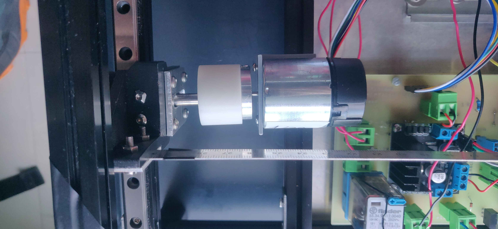
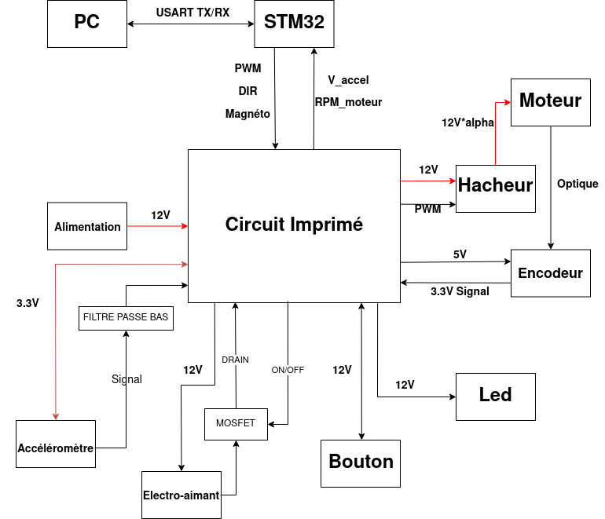
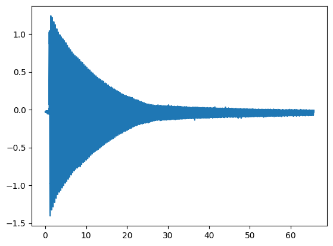
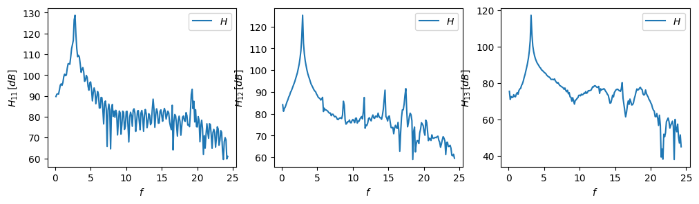
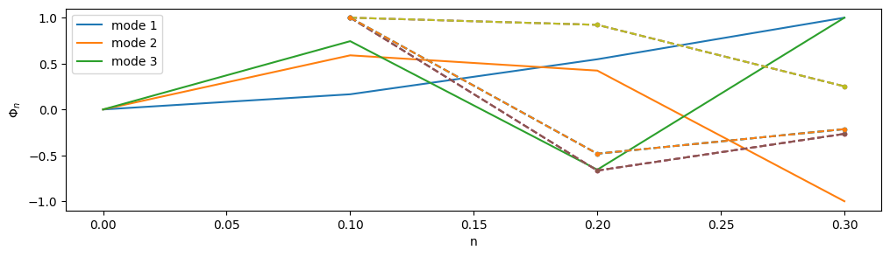
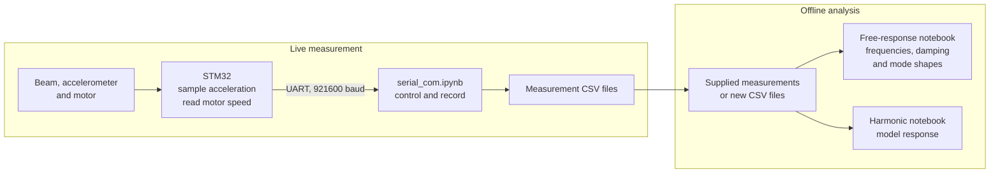

<div align="center">

# Flexion XS

🇫🇷 **FR -** **Mesurer les vibrations d’une réglette en flexion et confronter les fréquences et modes observés à un modèle mécanique.**

🇬🇧 **EN -** **Measure the vibrations of a bending beam and compare its observed frequencies and mode shapes with a mechanical model.**

[Retour au portfolio / Back to portfolio](https://github.com/mlmdc) · [Sommaire / Contents](#sommaire--contents) · [Tutoriel de mesure / Measurement guide](0_Documents/Sources/tutoriel.md) · [Projet STM32](REGLETTE_CMV/REGLETTE_CMV.ioc) · [Analyse modale / Modal analysis](5_Post-traitements/1_Libre/analyse_modale_flexion_vfinal.ipynb)



</div>

## Sommaire / Contents

- [Présentation / Overview](#présentation--overview)
- [Problématique et approche / Problem & approach](#problématique-et-approche--problem--approach)
- [Choix techniques / Technical decisions](#choix-techniques--technical-decisions)
- [Résultats et apprentissages / Results & learnings](#résultats-et-apprentissages--results--learnings)
- [Getting started](#getting-started)
- [Organisation du dépôt / Repository layout](#organisation-du-dépôt--repository-layout)

## Présentation / Overview

🇫🇷 **FR -** Flexion XS est une plateforme expérimentale pédagogique consacrée aux vibrations d’une réglette assimilée à une poutre. Une carte STM32 acquiert l’accélération d’un accéléromètre analogique et la vitesse d’un moteur ; un programme Python permet de commander la maquette et de recevoir les mesures. Les notebooks exploitent ensuite des mesures en plusieurs points pour étudier les fréquences propres, les formes modales et l’amortissement, et les comparer à un modèle de poutre.

Le dépôt s’adresse aux étudiants et aux personnes qui reprennent le projet : il rassemble le firmware, l’outil de mesure, des données, des analyses et les documents de conception. Une acquisition en direct nécessite la maquette et sa carte STM32.

<br>

🇬🇧 **EN -** Flexion XS is an educational experimental platform for studying the vibrations of a beam-like strip. An STM32 board samples an analog accelerometer and reads motor speed; a Python program controls the rig and receives measurements. Notebooks then use measurements taken at several positions to study natural frequencies, mode shapes and damping, and compare them with a beam model.

The repository is intended for students and project maintainers. It contains the firmware, measurement tools, sample data, analysis notebooks and design documents. Live acquisition requires the physical rig and its STM32 board.

### Fonctionnalités / Features

- 🇫🇷 **FR :** acquisition de l’accélération et de la vitesse du moteur ; commandes série pour la maquette ; export des mesures ; analyses des régimes libre et harmonique.
- 🇬🇧 **EN :** accelerometer and motor-speed acquisition; serial commands for the rig; measurement export; free-response and harmonic-analysis notebooks.

## Problématique et approche / Problem & approach

🇫🇷 **FR -** L’objectif est de caractériser la réponse vibratoire d’une réglette instrumentée, puis de confronter les observations à un modèle mécanique. Une mesure doit associer l’évolution temporelle de l’accélération aux positions d’observation et, en régime forcé, à l’excitation produite par le moteur. La chaîne mise en place va du capteur analogique à la STM32, puis à l’enregistrement Python et au post-traitement hors ligne.

Pour le régime libre, les notebooks calculent les réponses fréquentielles à partir des mesures d’accélération et estiment les fréquences et amortissements modaux, notamment par sélection de pics à −3 dB et ajustement de cercles. Les formes modales expérimentales sont comparées à celles d’un modèle éléments finis de poutre, avec notamment un critère MAC. Un notebook distinct étudie la réponse harmonique par superposition modale.

<br>

🇬🇧 **EN -** The aim is to characterize the vibration response of an instrumented beam and compare the observations with a mechanical model. A measurement must relate acceleration over time to the observation positions and, in forced response, to the excitation generated by the motor. The implemented chain runs from the analog sensor through the STM32 to Python recording and offline analysis.

For free response, the notebooks derive frequency-response functions from acceleration measurements and estimate modal frequencies and damping, including peak picking at −3 dB and circle fitting. Experimental mode shapes are compared with those from a finite-element beam model, including with the Modal Assurance Criterion (MAC). A separate notebook studies harmonic response using modal superposition.

## Choix techniques / Technical decisions

<p align="center">
  
</p>

🇫🇷 **FR :**
- **STM32F411 et HAL en C :** la carte regroupe l’acquisition ADC, l’encodeur moteur, la commande PWM et la liaison série. Le DMA et les interruptions périodiques limitent le travail bloquant pendant l’acquisition.
- **Accéléromètre analogique et encodeur :** ils permettent d’observer la réponse de la réglette et la vitesse d’excitation avec l’électronique disponible. L’acquisition actuelle repose sur un seul canal d’accéléromètre.
- **UART à 921600 bauds et trames texte :** le format délimité facilite l’inspection et l’exploitation depuis Python. Ce choix simple impose toutefois une charge de transmission et une synchronisation à surveiller.
- **Python, NumPy, SciPy et notebooks :** séparer la mesure du post-traitement permet d’explorer les méthodes sans modifier le firmware. Les analyses gardent des plages de sélection et paramètres manuels ; elles ne constituent donc pas un pipeline entièrement automatisé.
- **Modèle éléments finis :** les notebooks utilisent un modèle de poutre d’Euler–Bernoulli discrétisé, utile pour confronter fréquences et formes modales, mais qui repose sur des hypothèses simplificatrices par rapport à la maquette réelle.

<br>

🇬🇧 **EN :**
- **STM32F411 and C HAL:** the board handles ADC acquisition, the motor encoder, PWM control and serial communication. DMA and periodic interrupts reduce blocking work during acquisition.
- **Analog accelerometer and encoder:** these components measure the beam response and excitation speed using the available electronics. The current acquisition uses a single accelerometer channel.
- **921600-baud UART and text frames:** delimited values are straightforward to inspect and process in Python, at the cost of transmission overhead and synchronization constraints.
- **Python, NumPy, SciPy and notebooks:** separating acquisition from post-processing allows analysis methods to be explored without changing the firmware. The analyses use manually selected ranges and parameters, so they are not a fully automated pipeline.
- **Finite-element model:** the notebooks use a discretized Euler–Bernoulli beam model to compare frequencies and mode shapes. It simplifies the physical rig and its boundary conditions.

## Résultats et apprentissages / Results & learnings

🇫🇷 **FR -** Le dépôt contient trois séries de mesures (`P1FRF.csv`, `P2FRF.csv`, `P3FRF.csv`) et des notebooks qui produisent des réponses fréquentielles et des comparaisons modales. Les fichiers documentent une chaîne expérimentale et des méthodes d’analyse utilisables comme base de travail ; ils ne suffisent pas, à eux seuls, à établir une validation quantitative du modèle ou une précision générale des estimations.

Les documents du projet signalent plusieurs limites encore ouvertes : le troisième mode en régime libre reste à mieux identifier, l’ajustement des cercles et le traitement doivent gagner en répétabilité, et des problèmes d’intégration électrique (notamment de masses) compliquent l’utilisation de la maquette. Le firmware et le protocole série nécessitent également une vérification avant de considérer l’acquisition comme robuste. Les évolutions proposées comprennent la fiabilisation du câblage et de la communication, une acquisition multi-capteurs et des essais répétés avec paramètres et conditions consignés.

<br>

🇬🇧 **EN -** The repository includes three measurement series (`P1FRF.csv`, `P2FRF.csv`, `P3FRF.csv`) and notebooks that compute frequency responses and compare mode shapes. They document an experimental workflow and analysis methods that can be extended; by themselves, they do not establish quantitative model validation or general accuracy of the estimates.

The project documents identify open limitations: the third free-response mode needs better identification, circle fitting and data processing need to be more repeatable, and electrical integration issues—particularly grounding—complicate use of the rig. The firmware and serial protocol also need verification before acquisition can be considered robust. Proposed next steps include improving wiring and communication reliability, adding sensor channels, and repeating experiments while recording parameters and test conditions.







## Getting started

The commands below install the Python packages used by the measurement and analysis notebooks. Run them from the repository root.



The live acquisition path requires the physical rig. The analysis notebooks can also run directly on the supplied measurement files without hardware.

### Prerequisites

- Python 3.10 (the version documented for this project)
- JupyterLab
- For live acquisition: the physical rig, an STM32F411 board, STM32CubeIDE 1.12.0 / CubeMX 6.8.7, and a serial connection

### Install and launch the notebooks

```powershell
python -m venv .venv
.\.venv\Scripts\Activate.ps1
python -m pip install --upgrade pip
python -m pip install jupyterlab numpy matplotlib scipy pyserial
jupyter lab
```

### Analyze the supplied measurements

Open `5_Post-traitements/1_Libre/analyse_modale_flexion_vfinal.ipynb` in JupyterLab and run its cells in order. The notebook reads the three semicolon-delimited files in `Measurements/`. The files contain time and acceleration samples; no live hardware is needed for this analysis.

For the harmonic case, open `5_Post-traitements/2_Harmonique/analyse_harmonique_flexion_v1.ipynb`. Its model parameters and simulation settings are defined in the notebook.

### Acquire a new measurement

Open `REGLETTE_CMV/REGLETTE_CMV.ioc` in STM32CubeIDE and build/flash the firmware. Then open `serial_com.ipynb` and connect to the board's serial port at **921600 baud** before running its acquisition cells. The current notebook's automatic port detection expects a particular ST-Link description; on Windows, set the correct `COM` port if it is not detected. The measurement guide explains the physical setup and operation: [0_Documents/Sources/tutoriel.md](0_Documents/Sources/tutoriel.md).

Check the emergency stop, power wiring and grounding before operating the motor or electromagnet. Hardware measurements are not reproducible from software dependencies alone.

## Organisation du dépôt / Repository layout

| Path | Contents |
| --- | --- |
| `REGLETTE_CMV/` | STM32CubeIDE project, firmware and board configuration |
| `serial_com.ipynb` | PC-side serial connection, commands and measurement workflow |
| `Measurements/` | Three sample acceleration time series and CSV helper |
| `5_Post-traitements/1_Libre/` | Free-response and modal-analysis notebook versions |
| `5_Post-traitements/2_Harmonique/` | Harmonic-response analysis notebook |
| `0_Documents/` | Measurement guide, project documents and their sources |
| `1_Documentation_codes/` | Code documentation and Python serial module requirements |
| `2_Conception_électronique/` | Electronics design files and activity report |
| `3_Conception_Mécanique/` | CAD parts, assembly and 3D-print files |
| `4_Medias/Photos/` | Rig, wiring and analysis images |

## License

This project is licensed under the MIT License. See the [LICENSE](LICENSE) file for details.
